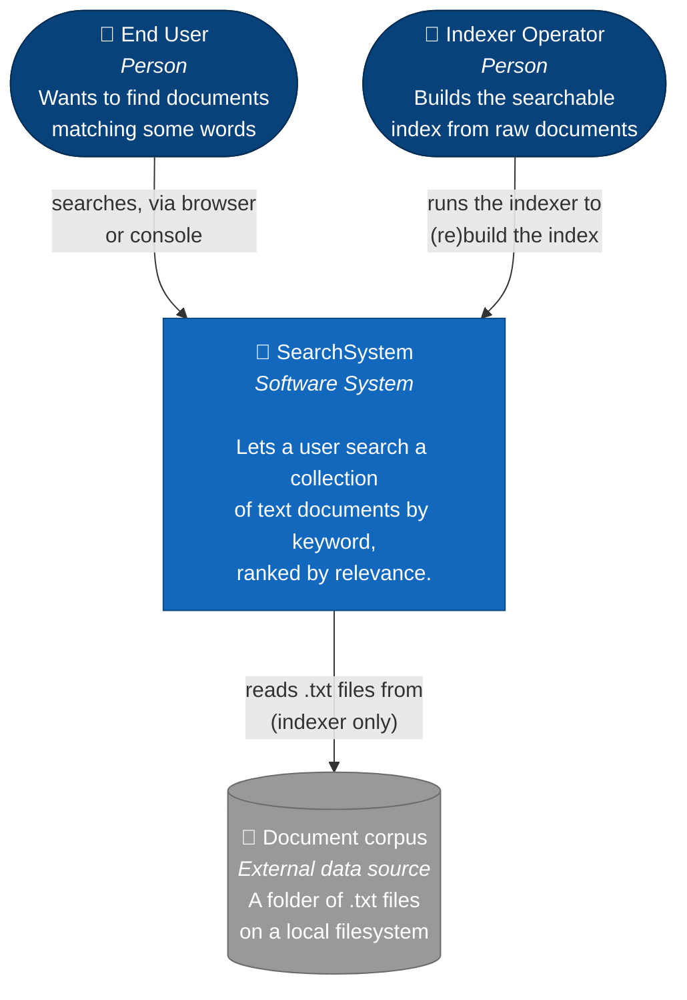

# C4 Model — Level 1: System Context

> Scope: **SearchSystem** ("Søgle"), the search engine built for the *Arkitektur principper* course.
> This is the outermost view: one box for the whole system, the people who use it, and the one external
> thing it depends on. No technology, no internal structure.

## What the system does

SearchSystem lets a person search a collection of `.txt` documents and get back a ranked list of the
documents that contain the query words, with basic case-sensitivity control. It also has to be *built*:
someone first has to point an indexer at a folder of documents so there is something to search.

Those are two different kinds of use, by two different actors.

## Actors

| Actor | What they do |
|---|---|
| **End User** | Searches the indexed documents, either through the web UI ("Søgle") or a console REPL. Reads ranked results and which query words were missing/ignored. |
| **Indexer Operator** | Runs the indexer offline against a folder of `.txt` files to (re)build a searchable index before anyone can search it. In this codebase, currently a developer running it from the command line — not an end-user-facing role. |

## External dependency

| External system | Relationship |
|---|---|
| **Document corpus** (a folder of `.txt` files on a local filesystem) | The only outside data source. The indexer reads it; nothing else in the system talks to it. |

Everything else — the database file(s), the HTTP APIs, the web and console clients — is **inside** the
system boundary at this level of zoom. That includes the database: it's private state SearchSystem
manages for itself, not a shared external system, so it doesn't appear as a separate box here (it does
at [Container level](02-containers.md)).

## Diagram

## Notes / things worth knowing when you drop to Container level

- There is no single "SearchSystem" *process*. It's a handful of independently run .NET
  processes/applications (indexer, one or more search API instances, a coordinator, two kinds of client)
  that together provide this one capability. See [02-containers.md](02-containers.md).
- The End User's two entry points (web UI vs. console) are not two different systems — they're two
  clients of the same backend, kept for teaching purposes (the course wants both a Blazor client and a
  plain HTTP client).
- The Indexer Operator interaction is **offline / batch**: it happens before searching, not during a
  search request, and must be re-run (with the target API instance restarted) whenever the corpus
  changes — the search side caches its word table in memory for the life of the process.
