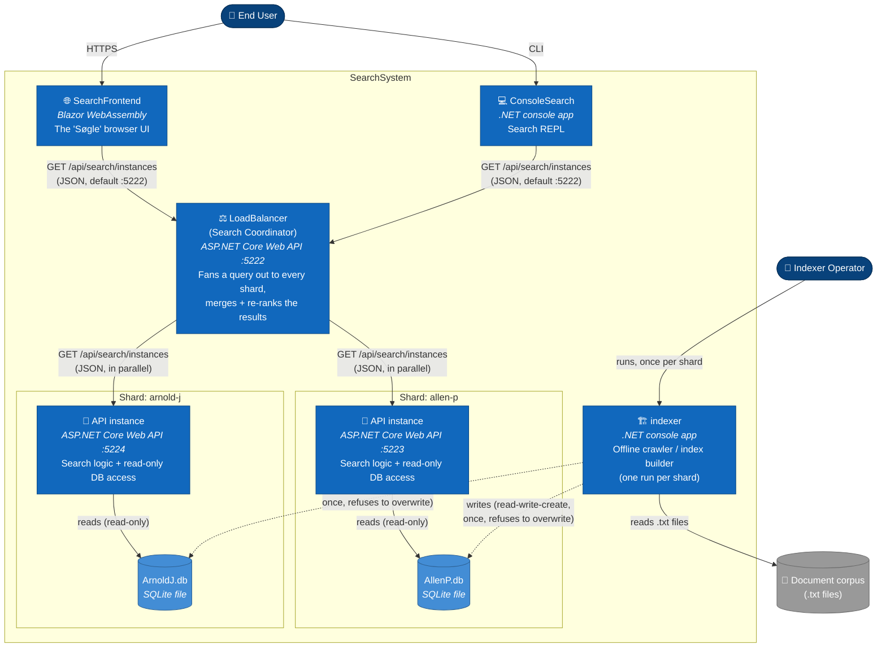

# C4 Model — Level 2: Containers

> Zooming into **SearchSystem** from [01-system-context.md](01-system-context.md): the independently
> runnable/deployable units, the technology each one uses, and how they talk to each other. A "container"
> here is a .NET application or database file — not a Docker container.

## Containers

| Container | Technology | Responsibility |
|---|---|---|
| **SearchFrontend** | Blazor WebAssembly (runs in the browser) | The "Søgle" web UI. Landing page, search box, results view, case-sensitivity toggle. HTTP client only — no search logic. |
| **ConsoleSearch** | .NET console app (REPL) | Command-line search client with the same capabilities as the web UI. HTTP client only — no search logic. |
| **LoadBalancer** (Search Coordinator) | ASP.NET Core Web API | Fans one search request out to every shard **in parallel** and merges the results into one ranked answer. Despite the project name, it no longer round-robins — see [Container: scaling model](#the-scaling-model-multiple-api-shards) below. |
| **API** | ASP.NET Core Web API | The actual search service. Owns the search logic and one shard of the SQLite index. **Run as multiple independent instances** (see below), not a single process. |
| **indexer** | .NET console app (offline batch job) | Crawls a folder of `.txt` files, extracts words, and writes a reverse index into one shard's database. Never runs alongside a search request — it's a build step. |
| **AllenP.db / ArnoldJ.db** (and any further shard files) | SQLite file | One database file per shard, written once by an `indexer` run and then read-only for the rest of its life by exactly one `API` instance. |
| *Postgres database* | PostgreSQL | An alternate target the indexer can write to instead of SQLite. Not used by the search side at all — `API` is SQLite-only. Effectively a legacy/optional path, kept for the course's DB-comparison exercises. |

`Shared` (a class library) isn't a container in the "independently deployable" sense — it doesn't run on
its own — but every container above is compiled against it. It defines `Shared.Contracts.SearchResponse`
(the one wire format used by every HTTP call in the diagram below) plus `Paths` and `BEDocument`. It's
what lets the coordinator, both API shards, and both clients agree on a JSON shape without four separate
copies of it.

## The scaling model: multiple API shards

This is the interesting part of the current branch (`y-skalering-DB`). Rather than one `API` process
serving the whole document collection, the collection is **partitioned ("sharded") across several `API`
instances**, each with its own private SQLite file:

- Two shards ship in this repo's `launchSettings.json`: `allen-p` on `:5223` → `AllenP.db`, and
  `arnold-j` on `:5224` → `ArnoldJ.db`. Both are the exact same `API` code; only the configured
  `Search:SqliteDatabasePath` (and port) differ per instance.
- Partitioning happens **at index-build time**, not at query time: you run `indexer` once per shard, each
  time pointed at a disjoint slice of the corpus and a different `--sqlite-database-path`. There is no
  routing logic anywhere that decides "this document lives on this shard" — that's a manual/deployment
  concern, not a runtime one.
- `indexer`'s SQLite path now refuses to run against a database that already holds documents
  (`HasIndexedDocuments` guard in `indexer/DatabaseSqlite.cs`), specifically so you can't accidentally
  wipe an already-built shard by rerunning the indexer over it. The Postgres path was **not** given this
  guard — it still drops and recreates its tables unconditionally.
- `LoadBalancer` is the **scatter-gather coordinator**: on every query it calls all shards concurrently
  (`Task.WhenAll`), sums their hit counts, unions/re-intersects their "ignored" words (a word is only
  globally ignored if *every* shard ignored it), concatenates their document hits, re-sorts the combined
  list by hit count, and takes the top `maxAmount`. If any one shard is unreachable, the whole request
  fails with `502 Bad Gateway` — there's no partial-result degradation.
- Both clients (`SearchFrontend`, `ConsoleSearch`) now default to the coordinator's port (`:5222`), not a
  shard's port directly — searching "through the front door" always means going through `LoadBalancer`.
  Hitting an `API` shard's `:5223`/`:5224` directly still works (same route, same contract) but only
  searches that one shard's slice of the corpus.

See [03-components.md](03-components.md) for the component that implements this
(`LoadBalancer.Controllers.SearchController`) and [04-code.md](04-code.md) for its actual code.

### A dead end worth knowing about

Two empty folders, `SearchCore/` and `SearchRepository/`, still sit at the repository root. They are
**not part of the solution** (not in `SearchSystem.sln`, no `.csproj`, not tracked by git on this branch)
— an earlier commit split the search logic and the SQLite repository out into those two projects, a later
commit reverted that and moved the code back into `API/Search` while adding `LoadBalancer` instead. They
aren't containers; they're history. Mentioned here only so they don't get mistaken for a fourth live
service.

## Diagram

## Ports (Development launch profiles)

| Container | Port | Launch profile |
|---|---|---|
| LoadBalancer (coordinator) | `5222` | `http` |
| API — shard `allen-p` | `5223` | `allen-p` |
| API — shard `arnold-j` | `5224` | `arnold-j` |
| SearchFrontend | `5136` | `http` |

## Data flow summary

1. A user searches from `SearchFrontend` or `ConsoleSearch`; both send one HTTP GET to `LoadBalancer` on
   `:5222`.
2. `LoadBalancer` sends the same GET to every configured shard `API` instance concurrently.
3. Each `API` instance answers using only its own shard's SQLite file.
4. `LoadBalancer` merges, re-ranks, and truncates the combined results, and returns one
   `Shared.Contracts.SearchResponse` to the client.
5. Building an index happens completely separately, offline: `indexer` reads `.txt` files from the corpus
   and writes into exactly one shard's SQLite file per run. An `API` instance must be **restarted** after
   its shard is (re)indexed, because it caches the word table in memory for its whole lifetime.
