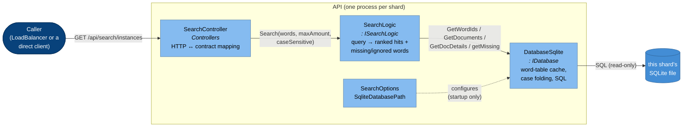
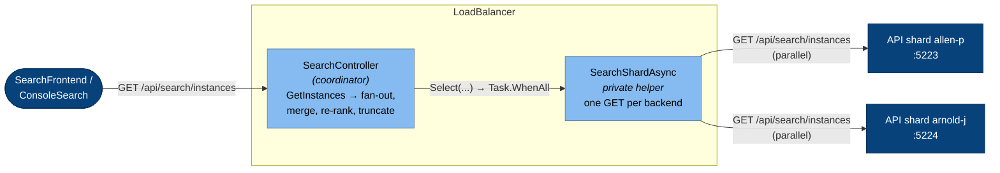
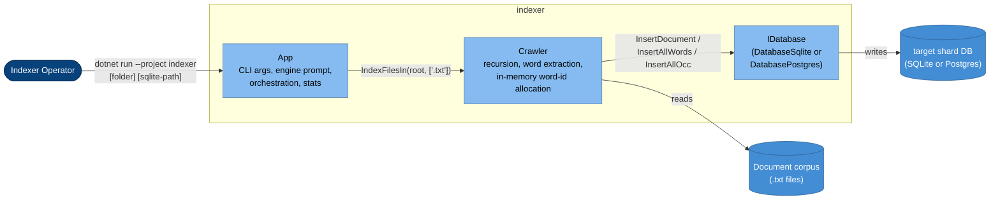

# C4 Model — Level 3: Components

> Zooming into the three containers from [02-containers.md](02-containers.md) that actually contain
> logic: **API**, **LoadBalancer**, and **indexer**. `SearchFrontend` and `ConsoleSearch` are left out —
> each is just one HTTP client class plus a UI/REPL shell wrapped around it, not interesting enough to
> decompose further for this course. `Shared` is a plain data-contract library, referenced by everything
> below but not shown as its own diagram.

## Container: API

The search service. One process per shard; every shard runs the identical set of components below,
differing only in which SQLite file `DatabaseSqlite` is constructed with.

| Component | File | Responsibility |
|---|---|---|
| `SearchController` | `API/Controllers/SearchController.cs` | The HTTP face. Parses/validates query params, calls `ISearchLogic.Search`, maps the internal `SearchResult` onto the shared wire contract `SearchResponse`. Holds no search logic of its own. |
| `ISearchLogic` / `SearchLogic` | `API/Search/ISearchLogic.cs`, `SearchLogic.cs` | The actual search algorithm: turn query words into word ids via `IDatabase`, ask for matching documents, compute which query words are missing from each hit. |
| `IDatabase` / `DatabaseSqlite` | `API/Search/IDatabase.cs`, `DatabaseSqlite.cs` | Read-only persistence for this shard. Caches the *entire* `word` table in memory on first use (`mWords`, `mWordsIgnoringCase`) so repeated searches don't re-read it, and folds casing in memory to support case-insensitive search. |
| `SearchOptions` | `API/Search/SearchOptions.cs` | Just the injected `SqliteDatabasePath` for this instance — the one thing that varies per shard. |
| `ServiceCollectionExtensions.AddSearch` | `API/Search/ServiceCollectionExtensions.cs` | Composition root for this container: registers `SearchOptions`, `IDatabase → DatabaseSqlite`, `ISearchLogic → SearchLogic`, all as **singletons** (required — `DatabaseSqlite` holds one open connection and a process-lifetime cache). |

Notes:
- `mWords`/`mWordsIgnoringCase` inside `DatabaseSqlite` are loaded once, lazily, on the first search — this
  is *why* a running `API` instance never sees words added by indexing after it started: restart it after
  reindexing that shard.
- `GetDocuments` builds its SQL by string-concatenating id lists rather than using parameters (read side
  only — the indexer's write side does use parameters). Fine for a PoC, worth flagging if this were
  production code, since the ids ultimately trace back to word-lookup results rather than raw user input,
  which limits (but doesn't eliminate the principle of) the injection risk.

## Container: LoadBalancer (Search Coordinator)

A single controller. Small enough that "components" here really means "the methods inside one class" —
but it's the component that implements the whole scaling story from
[02-containers.md](02-containers.md#the-scaling-model-multiple-api-shards), so it earns its own diagram.

| Component | File | Responsibility |
|---|---|---|
| `SearchController` (coordinator) | `LoadBalancer/Controllers/SearchController.cs` | Holds the hardcoded shard list (`Backends`), fans a query out to all of them concurrently via a named `HttpClient`, merges the per-shard `SearchResponse`s into one, and returns it. Returns `502` if any shard is unreachable. |

See [04-code.md](04-code.md#the-scatter-gather-coordinator-loadbalancercontrollerssearchcontroller) for
the exact merge logic (hit-count summation, "ignored" intersection, re-sort + truncate).

## Container: indexer

An offline batch job — no controllers, no HTTP. Run once per shard against a disjoint slice of the corpus.

| Component | File | Responsibility |
|---|---|---|
| `App` | `indexer/App.cs` | Entry orchestration: parses the two optional CLI args (folder, SQLite path), prompts for SQLite vs. Postgres, builds the right `IDatabase`, drives `Crawler`, prints stats. |
| `Crawler` | `indexer/Crawler.cs` | Walks the folder recursively; per `.txt` file, extracts a distinct-word set, allocates new word ids **in memory** (`words.Count + 1`), and writes the document + only the *new* words + one `Occ` row per distinct word. |
| `IDatabase` / `DatabaseSqlite` / `DatabasePostgres` | `indexer/IDatabase.cs`, `DatabaseSqlite.cs`, `DatabasePostgres.cs` | Write-side persistence, one engine chosen at startup. Distinct types from `API.Search.IDatabase` — no shared interface between read and write sides. `DatabaseSqlite` now guards against reindexing a non-empty database (`HasIndexedDocuments`); `DatabasePostgres` still unconditionally drops and recreates its tables. |

Notes:
- The `Crawler.words` dictionary is the single source of truth for word-id allocation across the whole
  run; only the *delta* (`newWords`) is written per file, which is why ids must be allocated in memory
  rather than by the database.
- Word extraction is presence-only (a `HashSet<string>` per file) — no term frequency, no stemming, no
  case folding at index time. Case-insensitive search is entirely a read-side concern, handled by
  `API.Search.DatabaseSqlite` folding the cached word table at query time.
