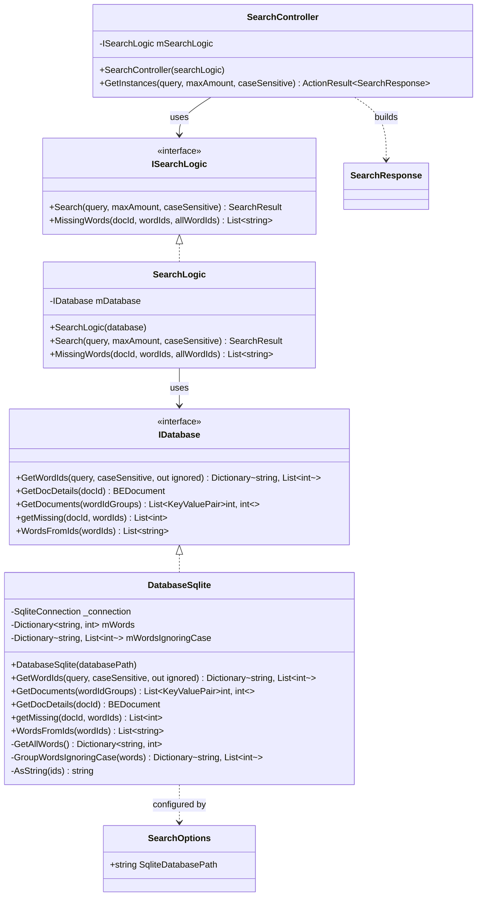
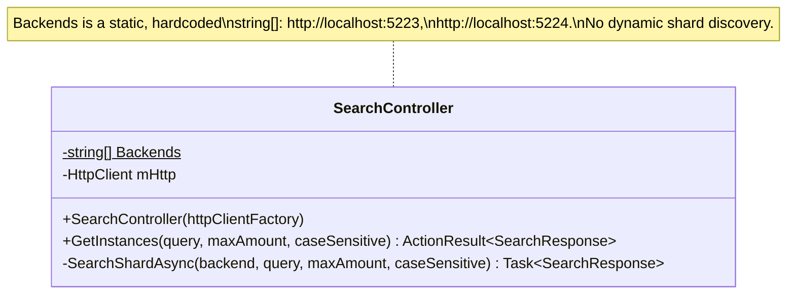
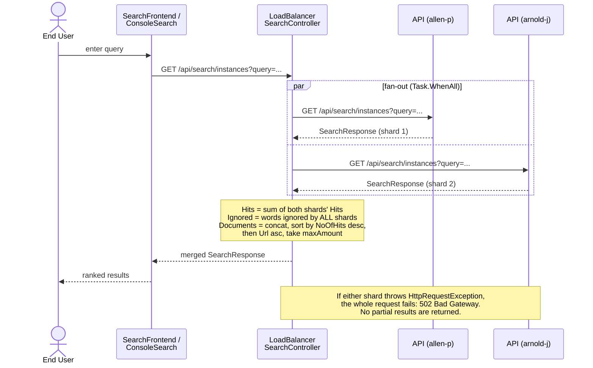
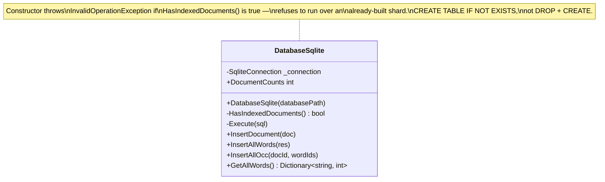

# C4 Model — Level 4: Code

> Zooming into the two components from [03-components.md](03-components.md) that are worth reading at
> class level: the search logic inside **API**, and the scatter-gather **coordinator** inside
> **LoadBalancer** — the class that implements the branch's whole "scale by adding shards" idea. Code
> diagrams age fast, so treat these as a snapshot of `y-skalering-DB`, not a contract.

## The search logic (`API.Search`)

Reading notes (file:line references are approximate to the current branch):

- `SearchLogic.Search` (`API/Search/SearchLogic.cs:20`) does three things in order: resolve query words to
  word ids via `IDatabase.GetWordIds`, rank candidate documents via `IDatabase.GetDocuments`, then for only
  the top `maxAmount` doc ids, fetch details and compute `MissingWords` per hit. It never touches SQL
  directly — that's entirely inside `DatabaseSqlite`.
- `DatabaseSqlite.GetWordIds` (`API/Search/DatabaseSqlite.cs:191`) is where the process-lifetime cache
  lives: `mWords`/`mWordsIgnoringCase` are populated on first call and never refreshed. This is the direct
  cause of "restart the API after reindexing its shard" from the container doc.
- `DatabaseSqlite.GetDocuments` (`API/Search/DatabaseSqlite.cs:34`) builds one `MAX(CASE WHEN wordId IN
  (...) THEN 1 ELSE 0 END)` term per query word so that a document counts each *query word* once no
  matter how many of its casings it contains — the comment in the source spells out the generated SQL for
  a 2-word, 3-id example.
- `SearchController.GetInstances` (`API/Controllers/SearchController.cs:32`) is intentionally thin: split
  query on spaces, validate, delegate, then hand-map `SearchResult`/`DocumentHit` fields onto
  `SearchResponse`/`DocumentHitDto`. It's the only place that knows about the wire contract on the service
  side.

## The scatter-gather coordinator (`LoadBalancer.Controllers.SearchController`)

`Backends` (`LoadBalancer/Controllers/SearchController.cs:13`) is a compiled-in list — adding a third
shard means editing this array and redeploying the coordinator, not a config change.

### Sequence: one search request across shards

This is the entire "y scale of the db" mechanism in the current branch: **no** consistent hashing, **no**
runtime routing table, **no** shard-awareness anywhere except this fixed `Backends` array. Scaling out
means (a) reindexing a new disjoint slice of the corpus into a new SQLite file, (b) launching another
`API` instance pointed at it, and (c) adding its base URL to `Backends`.

## The indexing safety guard (`indexer.DatabaseSqlite`)

Not part of the scaling *path*, but part of the scaling *story* — this is what makes it safe to run the
indexer once per shard without clobbering a shard that's already built:

Contrast with `Indexer.DatabasePostgres`, which still unconditionally `DROP TABLE`s in its constructor —
the safety guard was added only to the path actually used for sharding (SQLite), not to Postgres.
